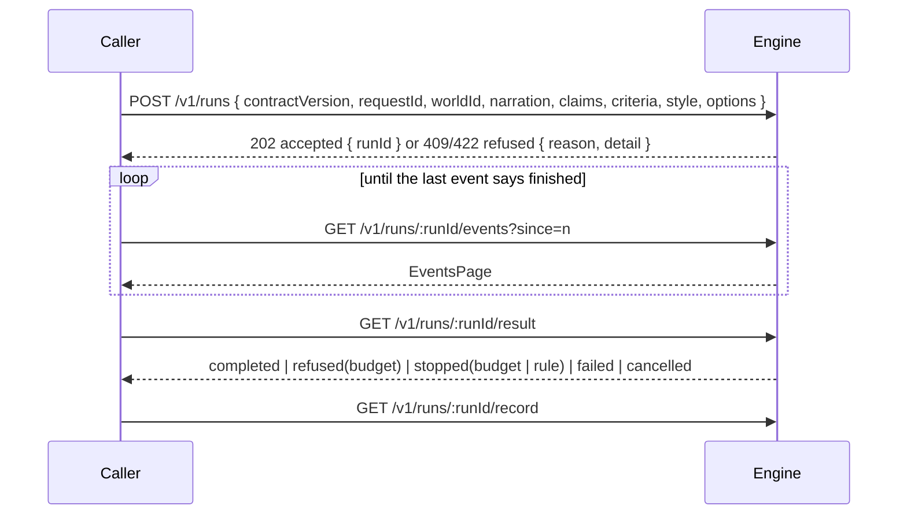

> **Moved here on 2026-09-14** from the KnowScroll repository's `steering/features/reel-contract.md`,
> once its four gates were approved, under **D-105**. Its history before the move is in that repository's git
> log. The decisions it cites live only at `steering-ref/steering/DECISIONS.md` (D-088, D-090). Where this file
> says it "moves to the engine repository once approved", that has now happened. From here on its slices are
> ticked and its journey recorded in this repository.

# reel-contract — how anything outside the engine asks it for a reel, and what it gets back

Status: verified
Decisions: D-020, D-042, D-047, D-056, D-062, D-063, D-064, D-069, D-073, D-083, D-092, D-093, D-094, D-095, D-096, D-097, D-098, D-099, D-100, D-101, D-102, D-105, D-106, I-4, I-14
Named only in Pending, as notes or as work handed to the engine features: D-015, D-034, D-054, D-059, D-082, D-085, D-103, D-104
Gates: product APPROVED 2026-09-14 adversarial-reviewer · architecture APPROVED 2026-09-14 adversarial-reviewer · program-design APPROVED 2026-09-14 adversarial-reviewer · slices APPROVED 2026-09-14 adversarial-reviewer

> **Created 2026-09-14 by D-093**, at the owner's request: the engine that calls us _"needs to know how
> to call us, and how we input, output"_. That caller is designed as the **Quartermaster**
> (`core-engine/15-VIDEO-SDK-INTEGRATION.md`, still `proposed`). This feature is the written agreement
> between it and the engine — **one engine**, whatever `reel-engine` and `reel-render` do inside.
>
> **Built in the engine repository** as `@cutroom/reel-contract` (D-094), and served by the engine
> running as its own service (D-098). The engine receives criteria and claim labels, never evidence
> (D-096), and returns the video without a sources card (D-101). This file is reviewed here and moves to
> the engine repository once approved (D-105).
>
> **Amended by `resume-failed` on 2026-09-26, Slice 4, in version 1 — the gates below are not edited, and no
> assertion is removed** (**S-161**, **S-162**, in S-034's form). **A new route, `POST /v1/runs/:runId/resume`**
> (`packages/reel-contract/src/resume.ts`, `routes.ts`): a strict `ResumeRequest` — `contractVersion`, an optional
> `remake` of pieces, an optional `preview: true` — answered by a `ResumeResponse` of four strict arms: `preview` (200:
> the pieces made again in shot order, `estimateCents` — what the reel spent plus the resume's estimate, the figure
> compared — `spentCents`, `capCents`, `ceilingCents`, and `limit` when one would be crossed); `accepted` (202: the
> new `runId`, the run it `resumes`, `replayed`); `refused` with a detail (409 `not-resumable` or `resumed`; 422
> `version`, `invalid` or `unsupported`); and `refused` for `budget` (409, D-100's figures and `spentCents`). 404 and
> 500 are `ErrorResponse`. **`Piece` is nested** — `kind` `still`, `narration` or `clip`, and an optional `shot` shaped
> `shot-<n>` — and carries no version (D-106). **`RunStatus` gains `resumes?` and `resumedBy?`, and each picture and
> take of `RunRecord` gains `keptFrom?`**, each absent — never null — on a run it does not apply to. `CONTRACT_VERSION`
> stays `1`: no caller exists for a bump to protect. **Checks 1, 2 and 5** (`reel-contract-shapes.test.ts`) gain
> `ResumeRequest` and each arm of `ResumeResponse` in `MESSAGES` and `Piece` in `NESTED`, each with a valid example,
> `RunStatus` examples carrying each pointer and a resumed `RunRecord` carrying `keptFrom`; their assertions are as
> written. **Check 18** (`reel-contract-following.test.ts`) gains a test: the stand-in, which never resumes
> (`resume-failed`'s Deferred 6), answers a resume of a known run `422` `refused`, reason `unsupported`, its `runId` the
> run, and of an unknown one `404 not-found` — each body parsed by the stand-in client, whose `Route`, `EXPECTED` and
> `routeOf` gain the route. **Lookup by `requestId`, and a replayed submit, answer the request's newest run** — its
> resume, when it has one (S-162); every request here has one run, so checks 13 and 27 read as they did.
>
> **Amended by `reel-stills` on 2026-09-16, in version 1 — the gates below are not edited.** Two
> things changed under decisions written for that feature, and are read there:
>
> - **`Criterion` now carries a required `type`**, `presence` or `event`, and **`mustNotShow` takes
>   `presence` only** (S-029, D-043). It amends **version 1**: `CONTRACT_VERSION` stays `1`, because no
>   caller exists for a bump to protect and an untyped criterion is refused either way (**S-034**,
>   D-106). _Pending_ item 2 below is answered by **S-030** and item 3 by **S-031**.
> - **_"`estimateCents` is the figure that was compared with the limit"_ still holds**, and for a
>   `stills` run refused at the ceiling that figure is **the pictures' share of the estimate**, not the
>   whole plan's (**S-030**).
>
> **Noted by `reel-render` on 2026-09-18 — nothing in this package changed, and the gates below are not
> edited (S-077).** Since `reel-render`'s Slice 4 **the real engine answers `until: 'video'`**: a
> completed run's result carries `video`, the assembled file's absolute path under the engine's artifact
> root, beside its `stills` and its `degradations` — the stills stage's in the order reached, then each
> shot whose clip was held to its narration, in shot order (S-073). **The record still lists pictures
> only**; its `degradations` list the same holds. Takes in the record are _Pending_ item 1, and go to
> `reel-takes`.
>
> **Amended by `reel-takes` on 2026-09-19, in version 1 — the gates below are not edited (S-093,
> S-099).** Since `reel-takes`' Slice 1 **`RunRecord` requires `takes`**: one entry per clip made, every
> attempt's, in the order made — a take cut off inside its checks too — each with its `takeId`, its
> `shotId`, its `number` (a whole number above 0), `used`, its `checks` (each gate it reached, `'2'` to
> `'5'`, with its outcome), and its `observationId` and `reconciliationId` where it reached them; the
> entry is strict. **`used` is true exactly for the takes a completed video run's video shows**, as
> `chosen` is for a picture; a plan or stills run's record has `takes: []`. `CONTRACT_VERSION` stays `1`,
> as S-034 kept it: no caller exists for a bump to protect. _Pending_ item 1 is answered by **S-093**.
> The shape check's example record and the stand-in service's records carry `takes: []` — test support;
> no assertion of this feature changed.

## Gate 1 — Product (no technical language)

**The problem.** Two things are being built apart: the part of KnowScroll that decides which reels should
exist, and the engine that makes them. The first time they meet should not be the first time either learns
what the other expects.

**What this is, and what it is not.** A description of the engine **as seen from outside** — what to send,
how and when to ask, and everything that can come back. It says **nothing about how the engine reaches its
answers**; that is the engine's own business, written in the engine's own plans. Anything that uses the
engine — the orchestrator first — should be able to work from this alone.

**The visible outcome.** A written, checkable agreement that says:

- **what to hand over** — the words the reel will say, sentence by sentence, each marked with labels for the
  claims it rests on, and which claims are the main ones; what each shot must show and must never show,
  already worked out; which place the reel belongs to and the look it should have; the most this reel may
  spend; and a name for the request, so that asking twice does not make two reels;
- **what must never be handed over** — where the claims came from and how sure anyone is of them. The engine
  gets labels, not evidence. Anything extra is turned away, not quietly ignored;
- **how to ask** — send the request, and hear at once either that it was taken, with a ticket, or why it was
  turned down;
- **what to ask while it works** — numbered updates, available at any time, so if you lose track or either
  side restarts, you carry on from the last number you saw;
- **what you get at the end** — the video, with its narration and captions; or which rule stopped it and at
  which step; or that it would cost too much, with the figures; or that you cancelled it; or that something
  went wrong inside the engine, said plainly. **The engine never sends where the claims came from — showing
  that to a viewer is KnowScroll's job**;
- **how it was made** — for every picture, which checks it passed or failed and what was made worse,
  available afterwards;
- **what it would cost** — ask for a plan only. That makes no pictures and no video, and tells you what the
  reel would cost to make as planned — or that every possible plan is over the per-reel limit. Asking for the
  real reel afterwards with the same request, changed only in its name, how far it goes and the most it may
  spend, plans the same way, as long as nothing about the engine has been changed in between. Making it can need extra attempts; if that passes or
  would pass your limit, it stops and tells you, with the figures.

**Surfaces.** None. An agreement between programs.

**The one measure allowed.** Whether something that follows the agreement gets exactly what it promises —
nothing missing, nothing extra — and whether something that breaks it is told so plainly.

**What must NOT happen.** The caller must never need to know how the engine works inside. It must never
receive a reel that looks finished but is not. And it must never be able to hand the engine the evidence
behind a claim.

## Gate 2 — Architecture

**Scope** (D-093, confirmed by the owner on 2026-09-14: a caller only needs the details of the API — how to
call it, what to call when, and what comes back). This gate describes the engine's outside only. Engine-internal
behaviour behind each answer — how plans are filtered, where a budget limit is read from, what the engine
records for itself — is `reel-engine`'s and `reel-render`'s, and is listed at the end as work handed to them.

**How to reach it** (D-098). The engine is a service on **the same machine**, reached over **HTTP** with
**JSON** bodies; money is **integer cents**; routes carry the version in the path (`/v1`); timestamps are
**ISO 8601 in UTC**. **The base URL is configuration on both sides** — version 1 fixes no port. _Version 1
assumes the loopback address and no authentication._

**The package** (D-094, D-099). `@cutroom/reel-contract` holds the message types, their schemas, the route
table as types, and `CONTRACT_VERSION`. It depends on **`zod` only** and imports no other `@cutroom/*` package,
so a caller that installs it gets nothing else of the engine. **A caller depends on this package and on no
other engine package.**

**Versions** (D-095, D-106). Every top-level message **and every event** carries `contractVersion`. A request
with a version the engine does not support is refused. Version 1 carries Phase 1's fields only.

**What to send** (D-096, D-102, D-062, D-069).

- the narration as **sentences**, each referencing claims **by opaque id string**;
- a **claim list** naming each id **once**, with its role, `main` or `supporting`;
- **`mustShow` and `mustNotShow`**, already computed, with the depiction-policy version they were computed
  against;
- the **world id** and the **style contract** (id, version, text);
- **options**: `until` — `plan`, `stills` or `video`; **`budgetCents`, required, a positive integer** — the
  most this run may spend on generation (D-100); and optionally `planVaryOn`, one of `shotCount`, `order`,
  `canonicalSubject`, `angle`; when absent, the engine uses its own configured default (D-092).

**What the narration must satisfy**, because a reel is 4 to 6 shots of about 40 seconds (D-063) and a shot is
never cut mid-sentence (D-073):

- **at least 4 sentences** — a shot is one narration unit and a unit never splits a sentence (D-073);
- **every claim in the claim list is referenced by at least one sentence** — a claim no shot can show makes
  every plan fail (D-063);
- **every `Criterion.claimId`, where present, is in the claim list**.

These are checked **at submit**. Whether the narration can actually be planned into 4–6 shots of about 40
seconds is decided **by planning, not at submit**: a narration that cannot be planned finishes as **stopped for
a rule at the `plan` step** (D-063, D-064).

**What must not be sent** (D-096, I-14). Sources, claim text, truth states, exposure. **Every schema is
strict**: a body containing any field the contract does not define is refused, never silently stripped.

**Routes and when to call them.**

| When                                 | Call                                 | Success                                                                                                                                                                 | Failure                                                                                                                                                                   |
| ------------------------------------ | ------------------------------------ | ----------------------------------------------------------------------------------------------------------------------------------------------------------------------- | ------------------------------------------------------------------------------------------------------------------------------------------------------------------------- |
| to start                             | `POST /v1/runs`                      | `202` `SubmitResponse` accepted                                                                                                                                         | `422` refused — version, invalid, unsupported · `409` refused — conflict. **Validity is checked first**: an invalid body is `422` even if its `requestId` was used before |
| to find a run again by your own name | `GET /v1/runs?requestId=`            | `200` `RunStatus`                                                                                                                                                       | `404` unknown · `400` empty or missing `requestId` — `ErrorResponse`                                                                                                      |
| to check where it is                 | `GET /v1/runs/:runId`                | `200` `RunStatus`                                                                                                                                                       | `404` `ErrorResponse`                                                                                                                                                     |
| to follow it                         | `GET /v1/runs/:runId/events?since=n` | `200` `EventsPage`; `since` absent means `0`; a `since` at or past the last event returns no events; `nextSince` is the last returned event's `seq`, or `since` if none | `404` unknown run · `400` a `since` that is not a whole number ≥ 0 — `ErrorResponse`                                                                                      |
| when events say it has finished      | `GET /v1/runs/:runId/result`         | `200` `RunResult`                                                                                                                                                       | `404` `ErrorResponse`; `409` `RunStatus` if not finished                                                                                                                  |
| for the record of how it was made    | `GET /v1/runs/:runId/record`         | `200` `RunRecord` once finished                                                                                                                                         | `404` `ErrorResponse`; `409` `RunStatus` if not finished                                                                                                                  |
| to stop it                           | `POST /v1/runs/:runId/cancel`        | `200` `RunStatus` — `running` until the stop takes effect, then `finished`; a finished run returns its finished status                                                  | `404` `ErrorResponse`                                                                                                                                                     |
| —                                    | any route                            | —                                                                                                                                                                       | `400` is `ErrorResponse` with `error: 'invalid'`; `404` with `error: 'not-found'`; `500` with `error: 'internal'` when the engine cannot answer at all                    |

**Rules a caller can rely on.**

- **Taken or refused at once.** `requestId` must be a non-empty string. A refused request creates no run and
  has no `runId`. A malformed body may have
  no `requestId` either, and the refusal says so. **`unsupported`** means the engine is running but cannot yet
  produce the requested `until` — for example a `video` request before the video half is built.
- **Asking twice.** The same `requestId` with the same content — compared as JSON values, so key order and
  spacing do not matter, while strings are compared exactly as sent — returns the same run with
  `replayed: true`. The same `requestId` with different content is refused as a conflict. **An estimate
  (`until: 'plan'`) and a real run are different requests**, with different ids.
- **Following a run.** Events are numbered from 1 per run and never renumbered; `since=n` returns exactly the
  events after `n`. The last event says the run has finished. A run and its events survive either side
  restarting.
- **Budget answers** (D-100, D-097). Every budget answer carries **which limit applied, the estimate, your
  ceiling and the per-reel cap**.
  - **Every plan over the per-reel cap.** The engine's plans are filtered at the per-reel cap (D-063); when none
    survives, the engine tries once more and then gives up (D-064, D-083). **The run finishes as refused for
    budget with `limit: 'reel'`**, having made no picture. This applies to plan-only requests too.
  - **The chosen plan over your ceiling.** For a full run, it **finishes as refused for budget with
    `limit: 'ceiling'`**, before any picture is made. **A plan-only request is not refused against your
    ceiling** — it spends nothing on generation and reports the estimate, and the caller decides.
  - **Passing a limit while being made** — or finding that it would. The run **finishes as stopped for
    budget**, carrying the same figures; what was spent is its `costCents`.
  - **`estimateCents`** is the figure that was compared with the limit: the chosen plan's estimate, or, when every
    plan was over the per-reel cap, the lowest of their estimates.
- **The estimate.** It is **what the reel would cost to generate as planned** (D-083). `costCents` counts
  generation spend only; planning is not generation, so a plan-only result's `costCents` is `0`. **Two requests
  with the same narration, claims, criteria, style, world and `planVaryOn` plan the same way** (D-062) — whatever
  their `requestId` and `until` — as long as nothing is reconfigured on the engine in between.
- **When a rule ends the reel.** Where the engine's decisions say _"the reel fails"_ — a picture, or a plan for a
  reason other than cost, that still fails its checks after the allowed retry (D-047, D-064) — the run **finishes as stopped for a rule**,
  naming the rule and the step.
- **When something goes wrong inside the engine.** `failed` is only for faults — a provider outage, a crash.
  A request the engine cannot answer at all gets `500`.
- **Cancel.** After a cancel takes effect, no further stage starts.
- **What comes back.** Pictures and the video are **absolute file paths on the engine's machine**, never bytes; the video is one progressive MP4 (D-056) with narration and captions, and **no sources card**
  (D-101). **Version 1 promises nothing about how long files stay** — a caller that needs a file afterwards
  copies it.
- **The record.** One entry **per picture made** — including both candidates for a shot, since both are
  checked (D-042) — with its `pictureId`, its shot, whether it was chosen, each check it reached with its outcome
  — `accept`, `accept_with_label` or `fail` (I-4) — and **the ids of the observation and reconciliation, for a
  picture that reached those steps**. Chosen pictures in a result carry the same `pictureId`. Plus every
  degradation.

**Where this is proven** (D-105). A journey in the engine repository, against a stand-in service; this file
moves there once approved.

**Expected call path.**



## Gate 3 — Program design

**File locations**, in the engine repository.

- `packages/reel-contract/src/version.ts` — `CONTRACT_VERSION`.
- `packages/reel-contract/src/request.ts` — `SubmitRequest` and what it contains.
- `packages/reel-contract/src/responses.ts` — `SubmitResponse`, `RunStatus`, `EventsPage`, `RunResult`.
- `packages/reel-contract/src/events.ts` — `RunEvent`.
- `packages/reel-contract/src/record.ts` — `RunRecord`.
- `packages/reel-contract/src/errors.ts` — `ErrorResponse`.
- `packages/reel-contract/src/routes.ts` — the route table, as types.
- `packages/reel-contract/src/index.ts` — the public surface.
- **Tests and the stand-in service live in the engine repository's `tests/`**, not in the package (D-094).

**Signatures.**

```ts
export const CONTRACT_VERSION = 1 as const
type V = { contractVersion: typeof CONTRACT_VERSION } // messages and events (D-106)

// request.ts — all schemas .strict()
export type ClaimId = string
export interface ClaimRef {
  id: ClaimId
  role: 'main' | 'supporting'
} // D-102
export type PlanVaryOn = 'shotCount' | 'order' | 'canonicalSubject' | 'angle' // D-062
export interface NarrationSentence {
  text: string
  claimIds: ClaimId[]
}
export interface Criterion {
  id: string
  text: string
  claimId?: ClaimId
}
export interface Criteria {
  mustShow: Criterion[]
  mustNotShow: Criterion[]
  depictionPolicyVersion: string
}
export interface StyleContract {
  id: string
  version: number
  text: string
}
export interface RunOptions {
  until: 'plan' | 'stills' | 'video'
  budgetCents: number /* positive integer */
  planVaryOn?: PlanVaryOn
}
export interface SubmitRequest extends V {
  requestId: string
  worldId: string
  narration: NarrationSentence[]
  claims: ClaimRef[]
  criteria: Criteria
  style: StyleContract
  options: RunOptions
}

// responses.ts
export type SubmitResponse = V &
  (
    | { outcome: 'accepted'; requestId: string; runId: string; replayed: boolean }
    | {
        outcome: 'refused'
        requestId?: string
        reason: 'version' | 'invalid' | 'conflict' | 'unsupported'
        detail: string
      }
  )
export type RunStatus = V & {
  runId: string
  requestId: string
  state: 'running' | 'finished'
  lastSeq: number
}
export type EventsPage = V & { runId: string; events: RunEvent[]; nextSince: number }

export interface StillRef {
  pictureId: string
  shotId: string
  path: string
} // absolute, on the engine's machine
export interface VideoRef {
  path: string
}
export interface Degradation {
  shotId: string
  reason: string
}
type BudgetFigures = {
  limit: 'reel' | 'ceiling'
  estimateCents: number
  ceilingCents: number
  capCents: number
} // D-097

type Finished = V & { runId: string; requestId: string; costCents: number }
export type RunResult = Finished &
  (
    | { status: 'completed'; until: 'plan'; estimateCents: number }
    | {
        status: 'completed'
        until: 'stills'
        estimateCents: number
        stills: StillRef[]
        degradations: Degradation[]
      }
    | {
        status: 'completed'
        until: 'video'
        estimateCents: number
        stills: StillRef[]
        video: VideoRef
        degradations: Degradation[]
      }
    | ({ status: 'refused'; reason: 'budget' } & BudgetFigures)
    | ({ status: 'stopped'; reason: 'budget' } & BudgetFigures) // spend is costCents
    | { status: 'stopped'; reason: 'rule'; rule: string; step: string; detail: string }
    | { status: 'failed'; detail: string } // neither budget nor a rule: outage, crash
    | { status: 'cancelled' }
  )

// events.ts — each event carries its own version (D-106)
export type RunEvent = V & { runId: string; seq: number; at: string } & (
    | { type: 'run.accepted' }
    | { type: 'stage.started' | 'stage.finished'; stage: 'plan' | 'stills' | 'video' }
    | {
        type: 'verdict'
        gate: string
        outcome: 'accept' | 'accept_with_label' | 'fail'
        shotId?: string
      }
    | { type: 'degraded'; shotId: string; reason: string }
    | { type: 'run.finished'; status: RunResult['status'] }
  )

// record.ts
export type RunRecord = V & {
  runId: string
  pictures: Array<{
    pictureId: string
    shotId: string
    chosen: boolean
    observationId?: string
    reconciliationId?: string // for a picture that reached those steps
    checks: Array<{ gate: string; step?: string; outcome: 'accept' | 'accept_with_label' | 'fail' }>
  }>
  degradations: Degradation[]
}

// errors.ts
export type ErrorResponse = V & { error: 'not-found' | 'invalid' | 'internal'; detail: string }
```

**Checks, written before the code.** One journey, `reel-contract` (D-020, D-105). They come in two kinds, and
say which:

- **Shape checks** examine the schemas and the package themselves. They run anywhere and need no service.
- **Behaviour checks** drive a **stand-in service** that honours the contract and can be told to produce each
  outcome — a refusal, a stop, a restart. **They prove the contract is complete and consistent, not that the
  real engine keeps it.** Whether the real engine keeps it is `reel-engine`'s and `reel-render`'s to prove.

_Shape — run anywhere_

1. `every top-level message schema and the event schema require contractVersion, and removing it from any of them fails validation; no other nested schema declares one; a page containing an event whose contractVersion differs from the page's fails validation` — D-106.
2. `every message round-trips through JSON.stringify and JSON.parse unchanged` — D-098.
3. `no field is named lane, tier, deadlineClass, epoch or warm` — D-095.
4. `no field is named source, sources, truthState, claimText, exposure or endCard` — D-096, D-101.
5. `every schema rejects a field it does not define, such as sources` — strictness at the schema.
6. `the request schema rejects a sentence referencing an id missing from the claim list, and a claim id listed twice` — D-102.
7. `the request schema rejects an unknown planVaryOn, and planVaryOn 'order' with no main claim; it accepts planVaryOn absent` — D-062, D-102.
8. `the request schema rejects a missing, zero, negative or fractional budgetCents; an empty requestId; fewer than 4 sentences; a listed claim no sentence references; a criterion claimId not in the claim list` — D-100, D-063, D-073.
9. `the package's only runtime dependency is zod` — D-094.
10. `@cutroom/reel-contract imports no other @cutroom package`, proven by a `drift:prove` case that imports **by package name** — D-094. **Blocked until the engine repository's resolver can see package-name imports; no other check waits on it.**

_Behaviour — against the stand-in_

11. `a submit with an unsupported contractVersion is refused 422 'version' with no runId; an invalid body whose requestId was used before is refused 422, not 409`.
12. `a malformed submit is refused 422 'invalid', with or without a requestId; a body carrying sources is refused, not stripped`.
13. `the same requestId and the same content in a different key order returns the same runId with replayed true; different content is refused 409 'conflict'`.
14. `a submit for an until the service cannot produce is refused 422 'unsupported'`.
15. `unknown requestId returns 404 and an empty requestId returns 400 on the lookup route`.
16. `an unknown runId returns 404 ErrorResponse on status`.
17. `an accepted submit returns 202 before any stage finishes; events are numbered from 1 and never renumbered; since=n returns exactly the events after n and nextSince is the last returned seq or since; since absent means 0; a since that is not a whole number ≥ 0 returns 400; an unknown runId returns 404 on events, result and record`.
18. `every body the stand-in serves on every route parses under its schema, and every event's at is ISO 8601 UTC`.
19. `result and record before the run finishes return 409 with RunStatus; after, a RunResult whose fields match its until and a RunRecord`.
20. `stills and video are absolute paths, never bytes`.
21. `record has one entry per picture made, both candidates of a shot included, and every chosen picture's pictureId appears in the result's stills` — D-042, I-4.
22. `a plan-only request above its ceiling completes with an estimate and costCents 0; a plan-only request whose plans all exceed the per-reel cap finishes refused for budget with limit 'reel'` — D-063, D-064, D-083.
23. `a full run refused for budget finishes with limit, estimateCents, ceilingCents and capCents, and no stills stage event` — D-097, D-100.
24. `a run stopped for budget finishes with the same figures` — D-100.
25. `a rule stop — including a narration that cannot be planned — names the rule and the step; an internal failure finishes as failed with a detail; a route the engine cannot serve returns 500 ErrorResponse internal` — D-047, D-063, D-064.
26. `cancel returns RunStatus running and later finished; no stage starts after it; the result is cancelled; cancelling a finished run returns 200 with its finished status; cancel on an unknown runId returns 404`.
27. `after the stand-in restarts, the run is found by requestId and events resume after the last seen number without gaps or repeats`.

**The four least confident decisions.**

1. **Events are fetched by asking, not pushed.** It survives a restart on either side with no extra machinery.
   _Rejected:_ a live stream now — version 2 can add one without breaking a caller that asks.
2. **Criterion text crosses as plain text.** It is an instruction, not evidence, but a careless one can restate
   a claim, and no schema can tell. _Rejected:_ criteria as ids only — nothing could plan a shot from an id.
3. **No promise about how long files stay.** Honest for version 1, and it pushes copying onto callers.
   _Rejected:_ a retention period — nothing yet decides one, and a promise nothing enforces is not a contract.
4. **Files are returned as absolute paths, not bytes or URLs.** Every caller is on the engine's machine
   (D-098), so a path is the cheapest correct answer. _Rejected:_ bytes in the response — large bodies for no
   gain; a download URL — a second route family version 1 does not need.

## Gate 4 — Slices

- [x] **Slice 1 — the package and its schemas.** `@cutroom/reel-contract`, strict schemas, route types,
      version, and **the new `reel-contract-is-a-leaf` rule in the engine repository's boundary config**, with a
      `drift:prove` case importing by package name. **Proves: 1–9, and 10 once the engine repository's resolver
      fix has landed.**
- [x] **Slice 2 — ask, and be answered at once.** A stand-in service in `tests/` with durable storage from the
      start, answering submit, the lookup by `requestId`, and status. **Proves: 11, 12, 13, 14, 15, 16.**
- [x] **Slice 3 — follow and receive.** Events, status, result and record for a completed run of each
      `until`. **Proves: 17, 18, 19, 20, 21.**
- [x] **Slice 4 — the answers that are not a reel.** Plan-only estimates, budget refusal and stop, rule stop,
      cancel — each outcome forced through the stand-in. **Proves: 22, 23, 24, 25, 26.**
- [x] **Slice 5 — restart, and the journey.** Stop and restart the stand-in on the same storage, then run every
      check. **Proves: 27, and re-runs 1–26. The journey cannot pass until check 10 can — so the engine
      repository's resolver fix blocks this feature's verification, not only one check.**

## Outcome

- [ ] Anything using the engine can work from this contract alone: what to send, when to call what, and every
      possible answer
- [ ] Every way of not getting a reel is a typed answer, never a crash and never a partial reel
- [ ] Nothing a caller can send lets the engine see the evidence behind a claim

## Evidence (newest first; appended by the journey, never typed by hand)

- 2026-09-30 journey=FAIL at 5bd079c — the check 'format' failed
- 2026-09-28 journey=PASS at 45b758f — every check green; 42 tests in tests/reel-contract-*.test.ts pass
- 2026-09-22 journey=PASS at cd18a22 — every check green; 41 tests in tests/reel-contract-*.test.ts pass
- 2026-09-22 journey=PASS at 24a79ed — every check green; 41 tests in tests/reel-contract-*.test.ts pass
- 2026-09-20 journey=PASS at 5f3c18b — every check green; 41 tests in tests/reel-contract-*.test.ts pass
- 2026-09-19 journey=PASS at 7d6cbd0 — every check green; 41 tests in tests/reel-contract-*.test.ts pass
- 2026-09-16 journey=PASS at 2b68bb8 — every check green; 41 tests in tests/reel-contract-*.test.ts pass
- 2026-09-14 journey=PASS at 0ae20f8 — every check green; 41 tests in tests/reel-contract-*.test.ts pass
- 2026-09-14 journey=FAIL at f8e1584 — the check 'decisions pin' failed

## Divergence (the first broken boundary, or "none")

the check 'format' failed

## Pending human decisions

**None blocking.** The owner confirmed on 2026-09-14 that the contract covers only what a caller needs, which
is D-093's definition. D-106 corrected D-104.

**Prerequisite owned by the engine repository, and it blocks this feature's journey:** the resolver setting
that lets its boundary rules see package-name imports. Check 10 waits on it, and the journey runs every
check.

**Known and deferred, by the owner's choice on 2026-09-14** — after five reviews he chose to fix by removing
promises and to record small leftovers here rather than loop. These are not regressions:

1. **Clips are not in the record.** D-015 traces seed-library assets, and clips are assets; the record covers
   pictures only. Adding clip entries is compatible with version 1 and belongs with `reel-render`'s gates.
2. **Which figure a `stills` run is admitted against** — the whole reel's estimate or only the stills' share — is
   not stated beyond "the figure that was compared"; `reel-engine`'s admission decides it.
3. **Whether Gate 1's four steps stop at the first failure** — so whether a failed candidate has an observation —
   is undecided anywhere; the record's ids are optional until it is.
4. **Q9's unverified billing rate** means real spend can differ from estimates; the budget stop reports it.
5. **D-106 narrowed the `Confirmed-by` of D-095**, which the owner chose, without asking him; it changes wording,
   not what D-095 chose.

**Q19** (how a viewer sees sources) is open and not touched: this contract promises no sources.

**Handed to `reel-engine` and `reel-render` — engine behaviour behind this contract's answers, removed from
this file on purpose:**

- **Proving the real engine keeps the contract.** Behaviour checks here run against a stand-in; the engine
  features prove their own implementation, including the answers above.
- **Budget internals** (D-100): the per-reel cap read from `steering/BUDGET.md` through `steering-ref`, and Gate
  0's threshold (D-063) and D-100's own text both written as the literal "$3.00" — the engine must use one
  figure for both, so the `capCents` a caller receives is the one Gate 0 applied; which questions file a refusal
  or a stop writes to (D-097, D-100); D-082's admission moving to the orchestrator.
- **Storage behind the rules above**: runs with their request ids and content comparison; an append-only event
  record per run; keeping files at the paths returned.
- **The estimate's reproducibility** (D-062) — proven against the real planner, not a stand-in.
- **Boundary rules inside the engine**: amending `contracts-are-a-leaf` so `@cutroom/contracts` may import the
  contract (D-099); D-103 retired D-085 but not D-034's drift test, which is binding again — the engine
  repository's `plan-no-epistemic` rule should be re-examined against it, not deleted on this file's say-so.
- **Sentences arrive already split.** D-073's splitter tests — including the one over a fixture with
  abbreviations and quoted speech — still run and still bind; they now test grouping of given sentences, and
  sentence detection happens before the engine.
- **The epistemic slice leaving the engine** (D-096), the style contract recorded as received, the world id
  recorded, and no `depiction_policy` table.
- **No end card** (D-101) — D-054's frame count and D-059's manifest, both `reel-render`'s.

**Handed to `reel-script`, on the KnowScroll side:** producing sentences, claim roles and criteria (D-096,
D-102).

## Gate review 1 — 2026-09-14, adversarial reviewer, evidence pack only

**Verdict: CHANGES REQUIRED on all four gates. Bar (a) fires; (b) and (c) do not.** The feature is
`blocked-on-human` on one question only the owner can answer (below). Every bar-(a) instance was
verified against `DECISIONS.md` before being recorded.

**The finding that changes the feature's shape, and corrects something told to the owner.** Gate 2
claimed that ratified D-067 overrules the Quartermaster design's line _"nothing epistemic enters the
harness"_, and the owner was told that line was out of date. **Both claims were wrong.** That line
restates **I-14**, a ratified invariant — _"Claims, sources, truth states and exposure stay in
KnowScroll, reaching the harness only as opaque metadata"_. And **D-067 does not overrule it; D-067
relies on it:** _"I-14 is about the harness, and the harness is parked … A full script reaching
`reel-engine` does not cross I-14's line."_

**But D-067's reason no longer holds, and nobody noticed.** When D-067 was written, `reel-engine` lived
in KnowScroll, so a script reaching it stayed inside KnowScroll. **D-088 and D-089 then moved the
engine into its own repository, whose packages are `@cutroom/*`, and the owner has said it becomes part
of Cutroom.** A full script with claims, sources and truth states entering that repository is exactly
what I-14 forbids. **Two ratified positions now point in opposite directions**, and a contract cannot
be written until one gives way. See _Pending human decisions_.

**Bar (a), verified.**

1. **D-014** — _"Exceeding any cap stops the job and writes a question to `QUESTIONS.md`."_ Gate 2 moved
   that duty to the caller and cited D-089, which is about where features are tracked, not what happens
   at runtime. A duty cannot move without a superseding decision.
2. **D-074** — _"Every claim carries its own `truthState`"_ and the reel's is computed by code.
   `Script.truthState` as one caller-supplied field is the option D-074 rejects.
3. **D-068** — per-reel `mustNotShow` additions are _"supplied by `reel-script` alongside the script"_.
   `ReelRequest` has no field for them, and callers may import nothing else.
4. **D-094** — the package holds _"only"_ types, schemas and the version; Gate 3 adds a conformance kit.
5. **D-095** — _"Every schema … has a required `contractVersion`"_; nested schemas such as `Script`,
   `StyleContractRef` and `StillRef` do not.

**The run model cannot be delivered as written.** A refusal before any job row has no
`correlation_id` to serve as `runId`. `events(since)` promises stable, replayable numbering, but D-002's
job row is updated in place and no event log exists anywhere. There is no way to re-attach to a run
after a restart except resending the whole request. And "in-process only" cannot coexist with "callers
import the contract and nothing else" — a package of interfaces cannot hand anyone a working engine.

**Also:** `ClaimRef`, `SourceRef`, `TruthState` and `Degradation` are used and never defined; `video?`
optional on a completed video run permits the half-made reel Gate 1 forbids; a budget refusal drops the
estimate figure; `requestId` idempotency cites D-081, which says nothing about request ids, and has no
column to live in; $3.00 is hardcoded while D-014 keeps caps in `BUDGET.md`; `admit()` takes no caller
ceiling; a mid-chain cap breach happens after spending, which "refused before spending" cannot
describe; checks 2, 5, 6 and 7 need `run()`, which arrives a slice later; check 16 against a stand-in
tests itself; and four checks cannot run through a kit that sees only the contract surface.

**Confirmed independently by the experiment the same day:** `@cutroom/contracts` importing
`@cutroom/reel-contract` trips `contracts-are-a-leaf`, and no rule enforces D-094's direction.

## Gate review 2 — 2026-09-14, second pass

**Verdict: CHANGES REQUIRED on all four gates. Bar (a) fires; (b) and (c) do not.** Most first-review
findings were verified genuinely fixed — D-074, D-068, undefined types, the optional video, refusals
with no run, re-attaching, in-process versus import, slice ordering. The new findings are mostly
**consequences of D-096 and D-098 that nobody traced**, and one contradiction between two decisions
written the same day. The four below were verified against `DECISIONS.md`.

1. **D-094 and D-098 contradict each other.** D-094: _"A caller such as the Quartermaster depends on
   this package"_. D-098's `Confirmed-by`: _"No `@cutroom/*` package is a dependency of any package in
   the KnowScroll repository."_ D-098 was written hours after D-094 without re-reading it, and carries
   no `Supersedes`. And D-098's _"validated by schema at both ends"_ needs the schema on the KnowScroll
   side, which one of the two forbids.
2. **D-096 left duties behind that need what it keeps out.** **D-008**: _"Captions and the sources end
   card are burned by ffmpeg from the app's own text"_ — the engine no longer receives source text, so
   the end card silently disappears. **D-076**: _"D-014's $40 seed total and $10/day still bind
   everything together"_, research included — research stays in KnowScroll, so the engine cannot compute
   the day or seed caps the contract promises to report. **D-015**: _"every `reel_asset` in the seed
   library resolves to a `witness_observation` and an `encounter_reconciliation` row"_ — those rows now
   live in the engine and no route reaches them. And **D-062's `order` axis**, _"chronological against
   claim-first"_, needs to know which claim leads, which opaque ids alone do not say.
3. **`PlanVaryOn` has nowhere legal to live.** The contract moves it into `reel-contract` and forbids
   `contracts` importing that package; D-092 puts the default in `contracts/src/cinematic.ts`; D-094's
   `Confirmed-by` bans declaring caller types in `contracts`. The alternative — amending
   `contracts-are-a-leaf` so `contracts` may import the contract — was never weighed.
4. **D-097 and D-014, again.** D-097 says the engine _"refuses **or stops**"_ and returns _"estimate,
   ceiling, which cap"_; `stopped` carries none of them. D-014 says _"Caps live in
   `steering/BUDGET.md`"_; the contract moved them into engine configuration and called that D-014.

**Also:** Gate 1's _"the real figure, not a guess"_ has no mechanism — an estimate is its own run and
the real run re-plans; a refused `SubmitResponse` requires a `requestId` a malformed body may not have;
a verdict is `accept | fail` while I-4 has `accept_with_label`; unknown fields are silently stripped by
default, so a body carrying `sources` would be accepted; the body hash is unspecified (key order alone
causes false conflicts); unknown `runId`, bad `since` and cancel-after-finish have no typed answer;
**checks 9–22 prove a stand-in, and nothing requires the same suite against the real service**; D-095
was satisfied by redefining "schema" inside a gate rather than by a recorded clarification; D-085's
`Confirmed-by` stays binding and can no longer be met; D-095's reasoning still rests on D-067.

**The pattern, stated once.** Every new decision today solved the question in front of it and was not
re-read against the decisions written just before it. D-077 against D-006 this morning; D-094 against
D-098 this afternoon.

## Gate review 3 — 2026-09-14, third pass

**Verdict: CHANGES REQUIRED on all four. Bar (a) fires; (b) and (c) do not.** This pass mostly
**confirmed fixes**: D-067/I-14, D-074, D-068, the conformance kit's placement, undefined types, the
optional video, refusals without a run, the event log, re-attaching, D-094 against D-098, the end card
(traced two steps — none remains outside superseded text), the day and seed caps, D-015's rows, the
`order` axis, `PlanVaryOn`'s home, `accept_with_label`, strict schemas and the body hash are all
recorded as genuinely fixed.

**Bar (a), what remains — verified where marked.**

1. **D-104 contradicts D-095 and itself** (verified). D-095: _"Every input, event and result carries
   `contractVersion`"_. D-104 says nested objects _"do not carry their own"_ and, one sentence later,
   that _"an event inside a page carries the page's version"_. The gate followed the first half and gave
   events no version. Under strict schemas, check 1's mismatch clause cannot fail on its own.
2. **The per-reel cap is still written in two places.** The contract says the cap is read from
   `BUDGET.md`, then restates D-063's literal $3.00 for Gate 0. With both at $3.00, a winner can never
   exceed the cap, so `refused` for `limit: 'reel'` is unreachable; the real cap event — both storyboards
   over $3.00 — maps to no result. D-100's cap-refusal question test has no typed path.
3. **A cap _stop_ writes no question.** D-097 says the engine _"refuses or stops … it does both"_; the
   contract attaches the question only to refusals, and `BudgetFigures` carries one limit where D-097's test
   asks for estimate, ceiling and the cap that fired.
4. **D-103 revives D-034's drift test.** Retiring D-085 _"entirely"_ removes what replaced D-034's
   `Confirmed-by`, which D-103 did not supersede — while the contract tells `reel-engine` to delete the rule.
5. **D-073's abbreviation-and-quotes test moves to KnowScroll with no decision.**

**Structural.** Check 28 — the suite runs unchanged against the real API — cannot hold: checks 14, 24, 25
and 27 need controls no route offers, and `reel-engine` stops at stills. Check 9's "contracts _may_
import" half is a non-violation `--prove` cannot show. Checks 5–7 say "refused", a service answer, in a
slice with no service; check 15 needs a route built a slice later. The ceiling is optional though D-100
says every run gets one. Gate 1's _"the same request plans the same way"_ conflicts with estimates and runs
being different requests, and ignores reconfiguration. Artifact file lifetime is unstated, which Q19's
append-a-card option would need.

**The reviewer's diagnosis of what is left.** Most remaining bar-(a) hits come from the contract
**re-describing engine internals** — Gate 0's threshold, which questions file, which drift rule — and
citing the decisions that govern them. A caller needs none of that.

## Gate review 4 — 2026-09-14, fourth pass, after the cut to caller-facing scope

**Verdict: CHANGES REQUIRED; bar (a) fires; (b) and (c) do not.** The cut worked: the reviewer judged the
engine-internal hand-offs legitimately out of scope, and checks 9, 28 and the optional ceiling fixed. What
remained was **caller-facing** — the right kind of finding for this document. Verified against source and
fixed in the revision above:

- **Budget answers contradicted D-063, D-064 and D-083.** A plan-only request was promised never to be refused
  for budget, but D-063 filters every plan at $3.00 and D-064 fails the reel when none survives. Now: every plan
  over the per-reel cap is `refused` with `limit: 'reel'`, plan-only included; plan-only is not refused against
  the caller's ceiling.
- **D-097's figures.** A budget answer now carries the estimate, the ceiling and the cap.
- **D-086 was cited for "paths, not bytes"**, which it does not decide. Citation removed; the choice is a
  least-confident decision with its rejected alternatives.
- **No answer for failure** — added `failed` and a `500 internal` error.
- **The record could not name a picture** — one entry per picture made, with required observation and
  reconciliation ids, joined to results by `pictureId`.
- **The estimate promise could never apply** — re-stated over the content that determines a plan, excluding
  `requestId` and `until`.
- **A client builder's guesses** — base URL, `unsupported`, empty `requestId`, absent `since`, timestamp format,
  record while running, cancel's state, 422-before-409, planning spend, what an estimate covers, narration
  minimums, unreferenced claims — each now stated.
- **Slices** — checks 15 and 16 moved to where their routes exist; the resolver fix recorded as blocking the
  journey; Slice 1 named as the one that writes the new boundary rule.
- **D-106's mismatch test cannot fail** while the version is a single literal — recorded in Pending and not
  used as a check.

## Gate review 5 — 2026-09-14, fifth pass

**Verdict: CHANGES REQUIRED; bar (a) fires three times; (b) and (c) do not.** Most review-4 fixes held —
budget answers for the all-over-cap case, D-097's figures, the D-086 citation, `failed` in the types, the
picture join, slice assignments. **All three bar-(a) findings are sentences added in the review-4 revision.**

1. **"Narration that still cannot be fitted … is refused as invalid"** is a submit answer, and deciding fit needs
   the planner. D-083: _"Planning cannot move into the API"_; D-073: only the planner imports the splitter;
   D-063 and D-064 already decide this case at Gate 0 — a shape failure, then one repair call, then the reel
   fails.
2. **The default axis is written into the contract's schema.** Check 8 rejects fewer than 6 sentences when
   `planVaryOn` is _absent_, which requires the contract to know the engine's default. D-092: the default _"can
   be changed in config"_ and is _"declared once, in `packages/contracts/src/cinematic.ts`"_ — and
   `reel-contract` cannot import it.
3. **D-106's mismatch test was dropped on a wrong premise.** It fails if an event's version is ever loosened
   from the literal while pages keep it — a realistic change when version 2 is prepared. A ratified
   `Confirmed-by` cannot be dropped by a note.

**Also introduced last round:** the estimate defined as the cost of reaching `until` with planning uncounted
makes every plan-only estimate zero, against Gate 1 and check 22; Gate 1 says a run _"never goes past the
limit"_ while Gate 2's budget stop reports spend after passing it (D-097: _"would be or has been"_); D-047 and
D-064's _"the reel fails"_ has no stated mapping, and an engine builder would send `failed`; the record's
_"always present"_ ids go beyond D-015 (seed-library assets) and D-042 (no rule that a candidate failing an
early step is observed); an empty `requestId` is accepted on submit and refused on lookup; `nextSince`, `since`
beyond the last event, `costCents` versus `spentCents`, and the 400's `error` value are undefined; the diagram
omits `failed`.

**The pattern, recorded.** Five reviews of this document. Each revision fixed what it was told and added new
prose that no one re-read against the decisions it touched. The re-reading rule was applied to decisions and
not to the sentences written in the gates.

## Gate review 6 — 2026-09-14, the narrow final check the owner chose

**Verdict: APPROVED on all four gates. Bars (a), (b) and (c) do not fire.**

Run as the owner specified after review 5: three questions only — does any caller-facing statement contradict
a ratified decision; does it touch an open question; could a competent engineer build a working client from
Gates 2 and 3 alone. Items on the _Known and deferred_ list were accepted by the owner and were not findings.

- **Review 5's three contradictions were confirmed gone**, and their replacements checked: the at-submit fit
  refusal now a rule stop at `plan` (D-063, D-064, D-083, D-073 respected); the default axis no longer in the
  contract (D-092); D-106's test restored clause by clause. The estimate matches D-083's wording; the budget
  answers match D-063, D-064, D-083, D-097 and D-100; _"at least 4 sentences"_ follows from D-063 and D-073.
- **One Gate 1 sentence contradicted D-062** — it said a later real request "with the same words, claims,
  instructions and look" plans the same way, omitting the axis and the world. **Fixed by replacing words, adding
  no promise**: "with the same request, changed only in its name, how far it goes and the most it may spend",
  matching Gate 2. The reviewer's optional narrowing was also applied: a rule stop covers _"a picture, or a plan
  for a reason other than cost"_, so an all-cost failure goes only to the budget refusal that carries D-097's
  figures. **The reviewer confirmed Gate 1 approved and the narrowing firing nothing.**
- **No open question touched** — Q19 is left entirely open; Q9's billing rate is assumed nowhere.
- **No client-breaking gap.**

**Still true after approval:** check 10 and therefore the journey wait on the engine repository's resolver fix;
under D-105 this file moves to the engine repository — not yet done.

## Session notes

**2026-09-14.** Created at the owner's request (D-093), then reviewed four times. Review 1 found the input
shape rested on a misreading of D-067; the owner's answers became D-096–D-098. Review 2 found D-094 and
D-098 in conflict and duties D-096 had left behind; the owner's answers became D-099–D-102, with D-103–D-105
recording consequences. Review 3 confirmed most fixes and traced the residue to the contract restating engine
internals; the owner confirmed the contract is for callers only, and D-106 corrected D-104. Review 4 found
caller-facing gaps — the budget answers against D-063/D-064/D-083, a missing figure against D-097, no failure
answer, pictures the record could not name — fixed in this revision. Gates are **written, not approved**.
