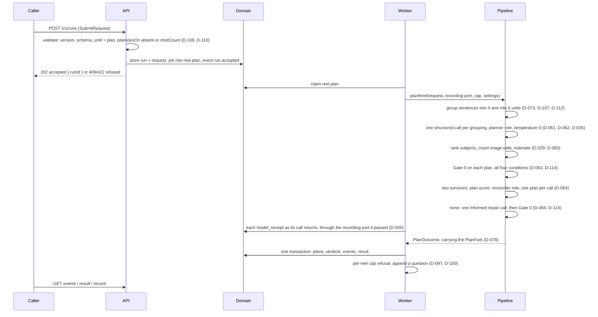

> **Moved here on 2026-09-14** from the KnowScroll repository's `steering/features/reel-plan.md`, once its four
> gates were approved, under **D-089**, **D-105** and **S-015**; the last steering commit holding it is `7a40970`.
> Where this file says "this repository" about git history, the reviews file or `QUESTIONS.md`, it means the
> steering repository, readable at `steering-ref/`. Decisions it needs from now on are written here (**D-115**,
> **S-017**). Its slices are ticked and its journey recorded here.

# reel-plan — the engine answers a request for a plan, for $0

Status: verified
Decisions: D-001, D-002, D-005, D-006, D-014, D-019, D-020, D-027, D-029, D-031, D-034, D-035, D-047, D-057, D-061, D-062, D-063, D-064, D-065, D-070, D-073, D-078, D-081, D-083, D-084, D-088, D-089, D-092, D-096, D-097, D-098, D-099, D-100, D-102, D-103, D-105, D-106, D-107, D-108, D-110, D-111, D-112, D-113, D-114, I-3, I-7, I-14, I-16, I-20, S-010, S-012, S-014, S-016
Named only in the deferral list: D-026, D-028, D-033, D-036, D-037, D-042, D-043, D-048, D-049, D-050, D-068, D-069, D-071, D-086, D-087, I-9, I-15
Gates: product APPROVED 2026-09-14 adversarial-reviewer · architecture APPROVED 2026-09-14 adversarial-reviewer · program-design APPROVED 2026-09-14 adversarial-reviewer · slices APPROVED 2026-09-14 adversarial-reviewer

> **Created 2026-09-14 by D-108**, which replaced `reel-engine` with this feature and `reel-stills`. The old
> file's plan is in this repository's git history at `7e50f79`; its four reviews and session notes are in
> `docs/founding/reel-creation-engine/reel-engine-reviews.md` (D-109).
>
> **Written by removing promises, not by patching.** Everything `reel-engine` promised that a plan-only engine
> does not need has been cut and is listed under **Deferred**, at the end, with where it goes. A reviewer
> should treat that list as known and chosen, not as findings.
>
> **Built in the engine repository** (D-088), `C:\Users\XZNON\Cutroom`. **This file moves there once its gates
> are approved** (D-089, D-105), and its journey runs there.
>
> **Amended by `reel-stills` on 2026-09-16 — the gates below are not edited, and no assertion is removed**
> (**S-047**). Where Gate 1 and _Outcome_ say pictures are "not built yet", that is now true of **video only**:
>
> - **`until: 'stills'` is accepted.** D-108's `Confirmed-by` scoped the stills refusal to _"a `reel-plan`
>   build"_, and `reel-stills`' Slice 2 built the chain, so **check 10 narrows to `video`** and its stills half
>   is asserted by `reel-stills`' check 8. Every test here that sent `until: 'stills'` to be refused sends
>   `video`.
> - **A `stills` run's plan stage is exactly the one below**, with one thing after it: a selected plan is
>   compared with the caller's ceiling by **the pictures' figure** (**S-030**, **S-035**), and an admitted run
>   gets the chain's second job row (D-081, D-083). A run that selects no plan ends exactly as this feature's
>   does (S-025), with no second row.
> - Its fixtures' criteria gained a `type` in Slice 1 (S-029, S-034).
> - **`GATE_ORDER` is `['0', '1', '1S']`** since `reel-stills`' Slice 3, as Gate 2 below said it would be
>   (_"`reel-stills` appends its gates"_). **Check 29 asserts that list**, and one assertion was added — Gate 0 is
>   still the first gate, the part of the check that was this feature's; none was removed (S-047). Plan verdict
>   events still carry gate `'0'`.
> - Both journeys are run again after `reel-stills`' Slice 5.
>
> **Amended by `reel-render` on 2026-09-16 and 2026-09-17 — the gates below are not edited, and no assertion is
> removed** (**S-077**). Where Gate 1 and _Outcome_ say a video is "not built yet", that is no longer true: every
> `until` is built, and the one request still answered "not built yet" is a `planVaryOn` other than `shotCount`
> (D-110):
>
> - **`until: 'video'` is accepted.** **Check 10 asserts it accepted with a `runId`, and keeps every assertion it
>   made of the refusal** — `422`, `unsupported`, the `requestId` echoed, _"not built yet"_, no `runId`, nothing
>   stored — made of `planVaryOn: 'order'`, in the same test. `reel-plan-run.test.ts` and `reel-plan-service.test.ts`
>   send `planVaryOn: 'order'` for their refusal (`reel-render`'s Slice 2).
> - **A `video` run's plan stage is exactly the one below**, with one thing after it: the selected plan's
>   `estimateCents` is compared with the caller's ceiling (**S-069**), and an admitted run gets the chain's second job
>   row. A run that selects no plan ends exactly as this feature's does.
> - **Check 3** asserts `LanguageModelPort`'s four calls, `judgeCut` added, and **check 29** asserts `GATE_ORDER` with
>   Gates 2 to 5 and 7 (`reel-render`'s Slice 1). Both lists stay exact.
> - This journey is run again in `reel-render`'s last slice.

## Gate 1 — Product (no technical language)

**The problem, in the owner's words.** "I have decided everything about how a reel gets made and none of it
runs." Four reviews of one large plan did not converge. The smallest piece that can run on its own, and be
useful to something, is the plan.

**The visible outcome.** Something asks the engine for a plan of a reel — the words, sentence by sentence,
with their claim labels, what the pictures must and must never show, and the most it may spend. It hears at
once that the request was taken, or why not. A little later it gets one of these answers:

- **what the reel would cost to make as planned**;
- **that every plan was over the per-reel limit**, with the figures;
- **which rule stopped it, and at which step**;
- that it was cancelled; or that something went wrong inside the engine, said plainly.

Behind the answer the engine keeps a record: **two plans of the same words**, one cut into four shots and one
into six; what the counting check said about each; which one was chosen and why; and, if both failed, the one
repaired plan and what happened to it.

**Asked for pictures or a video, it says "not built yet."** The same for asking the two plans to differ in any
way other than the number of shots.

**Surfaces.** None. A service other programs call.

**The one measure allowed.** Whether a plan that should pass passes, and one that should fail fails **at the
step the design says it fails at**.

**What must NOT happen.**

- **Nothing may be chosen without a record of why.** The plan that lost is kept, and it is never used instead.
- **Nothing may cost money, and nothing may read a secret.** This is structural, not a setting: this feature
  builds **no connection to any paid service at all** — its only way of asking a model is a stand-in that runs
  on this machine. It is proven by running the whole thing with no secrets in its surroundings.
- **Nothing may reach out of this machine.** The service answers only on this machine.

## Gate 2 — Architecture

**Where the code goes** — the engine repository's existing packages (S-010). Only what this feature touches:

| Package                  | This feature adds                                                                                       | May not                                                                            |
| ------------------------ | ------------------------------------------------------------------------------------------------------- | ---------------------------------------------------------------------------------- |
| `packages/reel-contract` | nothing — imported as it is                                                                             | —                                                                                  |
| `packages/contracts`     | the plan shapes, `LanguageModelPort` with its `structured` call, `ModelReceipt`, the plan settings type | import anything internal except `@cutroom/reel-contract` (D-099)                   |
| `packages/pipeline`      | the splitter, the planning stage and its plan score, Gate 0, ranking, the estimate — **pure functions** | import `domain`, `providers`, `apps`, any I/O module, or any npm package but `zod` |
| `packages/providers`     | **the stand-in `LanguageModelPort` only**                                                               | import `domain` or `pipeline`                                                      |
| `packages/domain`        | tables, migrations, the job queue, reading the per-reel cap                                             | import `pipeline` or `providers`                                                   |
| `apps/api`               | the contract's routes on the loopback address                                                           | import `providers` (D-005)                                                         |
| `apps/worker`            | the `reel.plan` job runner, and writing a question                                                      | —                                                                                  |

**No real model adapter is built here.** The MiniMax connection through the Vercel AI SDK (D-005, D-006) is
deferred. That is what makes Gate 1's "no connection to any paid service" structural: the only
`LanguageModelPort` in the repository is the stand-in.

**How a run goes.**



**The worker calls only `planReel`.** The splitter is called by the planning stage and by nothing else
(D-073).

### What a request becomes

**Refused at submit, beyond the contract's own schema checks:** `until` `stills` or `video` (D-108), and
`planVaryOn` `order`, `canonicalSubject` or `angle` (D-110) — each `422 'unsupported'`, no run. Absent
`planVaryOn` becomes `shotCount` (D-092) **when the engine builds its internal plan pair, whose `axis` is
required** — so D-062's _"a manifest pair whose declared `planVaryOn` is absent … fails schema validation"_
holds for the pair, and the contract's optional field holds for the request.

**Recorded as received:** the request itself, including the world id, the style contract and the criteria
with their depiction-policy version. **No depiction policy is stored or computed here** — KnowScroll computes
the criteria (D-096).

### The splitter (D-073, D-107, D-112)

It receives **the number of sentences** and a target unit count, and returns **contiguous groups of sentence
positions, in order**. It is told nothing else — not the text, not the claims, not any plan type — so it
**imports nothing outside its own folder**. Grouping rule: units as equal as possible in sentence count, any
extra sentences going to the earliest units. Fewer sentences than the target → it returns nothing, and the run
finishes as **stopped for a rule at the `plan` step, before any model call** (D-112) — rule `split`, detail
naming the sentence count and the target. **Its tests live under `tests/`**, since a test file inside its
folder would import `node:test` from outside it.

**"Never orphan a `claimRef`" under D-107.** A claim reference is attached to a sentence, and a sentence is
never divided, so each reference lands in exactly one unit exactly when each sentence lands in exactly one
unit. That is what the splitter's check asserts.

### The two plans (D-061, D-062, D-035, D-034)

One structured call per grouping, **role `planner`, temperature 0**, each given the sentences of its units,
the claim ids on each unit with their roles, and the criteria. The call returns **only what the planning layer
authors here**: for each unit, one shot with its duration in seconds and the ids of the subjects it shows; and
the subjects, named once (D-029 part 1).

**Computed by code after the call, never read from it** (D-034, D-035): the criteria the plan carries — every
supplied criterion, copied with its id and text — the subject ranking, the planned image-call count and the
estimate.

**One narration unit is one shot** (D-070). The call's schema refuses an answer in which a unit has two shots
or none (D-057's guard, named by D-070). **An answer the schema refuses finishes the run as `failed`**, with
the parse error as its detail — a model returning something that is not a plan is treated as a fault, not as a
plan that failed Gate 0 (see _Deferred_).

### Ranking and the estimate (D-029, D-027, D-083, D-100)

**Ranking** is D-029 part 3, exactly: subjects in two or more shots are eligible; ranked by shot count, then
earliest first appearance, then the order the plan names them. **Planned image calls:** rank 1, if any, costs
2 (best-of-2); ranks 2 and 3, where they exist, cost 1 each — **at most 4** (D-027). No state change can be
declared in this feature, so D-048's plan of 5 cannot arise here.

**The estimate**, in integer cents, is **what the reel would cost to generate as planned** (D-083):

`planned image calls × image rate + total shot seconds × video rate per second`

Both rates are **settings**. Their defaults are the budgeting rates `BUDGET.md` records today — **15 cents**
per image (`nano-banana-pro/edit`, the dearest of the four candidates, since no default is chosen (O-4) and
`BUDGET.md` budgets on the higher figure) and **4 cents** per second (H3 Turbo 768P, Q9 still unread). Every shot costs the same video with or without a keyframe (I-3), so the video term does not
depend on the ranking.

**The per-reel cap** is read from **`steering-ref/steering/BUDGET.md`**, the row _"Per reel, all-in"_, at the
start of each `reel.plan` job (D-100, D-014). **Gate 0 compares with that figure, and it is the `capCents` a
caller receives** — one figure, read once per job.

### Gate 0 (D-063, D-111, D-114)

Counting only; **no model call, and it imports no port type by name**. On each plan it checks **all four conditions** and
records every one that fails (D-114):

1. **coverage** — every claim in the request's claim list is referenced by a sentence in some shot's unit;
2. **criteria** — every supplied `mustShow` and `mustNotShow` criterion is on the plan with the same id and
   text (D-034, D-096, D-103);
3. **shape** — 4–6 shots; shot durations summing to **35–45 seconds** (D-111); every shot **5–15 seconds**
   (D-019);
4. **cost** — the estimate is **at or below the per-reel cap**.

**Conditions 1 and 2 cannot fail on a plan this feature builds**: D-070's guard makes every unit a shot, the
contract makes every claim referenced by a sentence, and criteria are copied by code. They are kept because
D-063 requires them, as backstops against a defect, and tested on plans built to break them. **In practice,
at the default rates, a plan here fails Gate 0 on shape**: the dearest possible plan is 4 × 15 + 45 × 4 = 240
cents, under a 300-cent cap. Tests of condition 4 set the rates higher.

`GATE_ORDER` is the literal `['0']`. `reel-stills` appends its gates.

### The plan score (D-064, D-113)

Computed **only when both plans survive Gate 0** (D-113). Higher wins; **ties go to the 4-unit plan**, the one
planned first — the shape of D-031 rule 4, where a keyframe tie goes to the first generated.

- **Countable terms, no model:** claim coverage, as a share of claims covered; subject recurrence, as the
  share of shots showing rank 1's subject.
- **Model terms:** Gate 7's four topics — beat order, pacing, juxtaposition, whether a shot repeats another's
  information — as **four closed questions, each answered `yes` or `no`**, asked of **each plan in its own
  call**, **role `reconciler`, temperature 0**. The question wording and every weight are **settings**,
  provisional until M-1 (D-064).

The score is a weighted sum with **non-negative weights over terms between 0 and 1**. It returns a number for
every input and has **no path that rejects** (I-16).

### Selection, repair and how a run ends (D-061, D-064, D-065, D-113, D-114)

- **Two survivors** → the higher score is selected; both keep their verdicts and scores.
- **One survivor** → selected outright (D-113); neither plan is scored.
- **No survivor** → **one repair call**, role `planner`, temperature 0, on the grouping D-114 picks, given both
  Gate 0 verdicts. The repair plan is recorded as a third plan marked `repair` and goes through Gate 0. If it
  survives, it is selected.
- **Repair fails too** → nothing is selected, and the run finishes:
  - **refused for budget, `limit: 'reel'`**, when **every** plan — both and the repair — failed condition 4.
    `estimateCents` is the lowest of the three estimates, `ceilingCents` the request's `budgetCents`, `capCents`
    the cap. **One entry is appended to the engine repository's questions file** (D-097, D-100);
  - otherwise **stopped for a rule**: rule `gate-0`, step `plan`, detail naming each plan's failed conditions.
- **Selected** → the run completes, `until: 'plan'`, with the selected plan's estimate and **`costCents: 0`**.
  **The request's ceiling is never compared** — the contract says a plan-only request is not refused against
  it. The caller's ceiling first matters when something is generated, which is `reel-stills`' (D-083).

**The questions file** is a setting, defaulting to `QUESTIONS.md` at the engine repository's root; it is
created on first write. Every test points it at a temporary folder. No other file is written except the
database.

### Storage (D-001, D-002, D-081, D-098)

SQLite through Drizzle, migrations under the existing tooling (S-012). **Tables added:**

- `run` — run id, request id, the request as received and as a canonical JSON value for comparison, state, the
  result once finished, a cancel flag;
- `run_event` — run id, `seq`, time, body; **append-only**, primary key run id and `seq`;
- `job` — kind, state, `correlation_id`, `parent_id`, `cost_cents`, attempts (D-002, D-081). A run has one job
  row, of kind `reel.plan`, whose `correlation_id` is the run id;
- `plan` — run id, role `a`, `b` or `repair`, unit count, axis, the plan as JSON, its Gate 0 verdict, its plan
  score when it has one, its estimate, whether selected (D-065, D-113);
- `model_receipt` — run id, role, model id, temperature, usage, `fake` (D-005, D-006).

**How the contract's rules are kept.**

- **Asking twice** — a submit with a used `requestId` compares its canonical JSON value with the stored one:
  equal returns the stored run with `replayed: true`, different is `409 'conflict'`. Validity is checked first.
- **Events** — numbered from 1 per run in the same transaction that writes them; `since=n` reads `seq > n`.
- **Receipts** — the worker hands `planReel` a **recording port**: the stand-in wrapped so that **each
  `model_receipt` is written as its call returns** (D-005, D-084). Receipts therefore survive a thrown call, a
  failed run and an interrupted job — every call that returned has one.
- **A restart** — a `reel.plan` job claimed and not finished is run again from the start. **A job writes its
  plans, verdicts, `stage.finished`, `run.finished` and the result in one transaction**, so an interrupted job
  leaves behind only `stage.started`, which is not written twice, and the receipts of the calls that returned.
- **A thrown call** — the worker finishes the run `failed`, with the error as its detail; the receipts already
  written stay.
- **Cancel** — sets the flag. The worker reads it before the plan stage starts; if set, the run finishes
  `cancelled` and no stage starts.

**Events a plan run emits:** `run.accepted`; `stage.started` and `stage.finished` for `plan`; one `verdict` per
plan, `gate: '0'`, outcome `accept` or `fail`, no `shotId`; `run.finished`. **The record** is a `RunRecord`
with no pictures and no degradations — this feature makes neither.

### The model port and the stand-in (D-006, D-084, D-005)

`LanguageModelPort` carries **one call here, `structured`**: prompt, schema, role, temperature in; the parsed
value and a `ModelReceipt` out. The receipt carries **the model id, the role, the temperature, usage and
`fake`**. Model ids per role are settings — `MiniMax-M2.7` for `planner` and `MiniMax-M3` for `reconciler`,
as D-006 routes them.

**The stand-in** (`packages/providers/src/fake/`) answers each call from a **script** a test supplies, keyed by
role and call order, **parses its own answer against the schema it was asked for** — so a script that does not
match fails the way a real answer would — and returns receipts with `fake: true` and zero usage. **It can be
scripted to throw**, which is how a test drives a run to `failed`.

### The boundary rules — what changes in the engine repository's config

Read on 2026-09-14; the config has sixteen rules today. **Every rule changed or added below gets a
`drift:prove` case that fires; `drift`, `drift:prove` and `drift --audit` pass with this feature's source
present** (S-014).

| Rule                                       | Change                                                                                                                       | Why                                                                                                                                                                                                                                                                           |
| ------------------------------------------ | ---------------------------------------------------------------------------------------------------------------------------- | ----------------------------------------------------------------------------------------------------------------------------------------------------------------------------------------------------------------------------------------------------------------------------- |
| `contracts-are-a-leaf`                     | also permits `packages/reel-contract/`                                                                                       | D-099 — `PlanVaryOn` and `Criterion` are declared only in the contract                                                                                                                                                                                                        |
| `plan-no-epistemic`                        | **deleted**                                                                                                                  | D-096: no epistemic module exists in the engine. **D-103 names D-096's criteria-narrowing test as D-034's enforcement** — Gate 0's condition 2, checked below                                                                                                                 |
| `split-no-cinematic`                       | **replaced by `split-imports-only-itself`**: nothing under `packages/pipeline/src/split/` imports a file outside that folder | Review 4 ran the old rule and found it cannot fire: every import of `@cutroom/contracts` resolves to its `index.ts`, whose path never contains `cinematic`. A splitter that imports nothing outside its folder imports no cinematic type by any path — D-073's `Confirmed-by` |
| `split-entered-through-its-index`          | `cinematic` removed from its `from` path                                                                                     | No gate creates `packages/pipeline/src/cinematic/`; left in, `drift --audit` fails once the pipeline has source                                                                                                                                                               |
| **`pipeline-npm-only-zod`** — new          | nothing under `packages/pipeline` imports from `node_modules` except `zod`                                                   | Review 4: `ai`, `drizzle-orm` or `better-sqlite3` passed every rule. `drift:prove` already builds package links under `node_modules` in its temporary tree for its by-name cases                                                                                              |
| `options.exclude`                          | `node_modules` removed from it                                                                                               | Without this, neither new rule can see an npm import (below)                                                                                                                                                                                                                  |
| **`model-client-only-in-providers`** — new | nothing outside `packages/providers` imports `ai` or `@ai-sdk/*`                                                             | D-084's _"no module outside `packages/providers` constructs a model client"_, and D-005's layer is the one client it could be                                                                                                                                                 |

**Two facts about the tool, found by running it on 2026-09-14** in a miniature pnpm-shaped workspace against
the engine repository's installed dependency-cruiser, not recalled:

- **The config's `options.exclude` removes every `node_modules` path from the graph**, so a rule about npm
  imports can never fire. **`node_modules` comes out of `exclude`**; `doNotFollow` still stops the tool going
  inside. With that change the two new rules fired on all five violating imports — `ai` from the pipeline and
  from `apps/worker`, `@ai-sdk/openai`, `drizzle-orm`, and an uninstalled `ai` — and stayed silent on
  `zod` under pnpm's store, on both workspace links, and on `ai` from `packages/providers`. The real engine
  repository with the changed config and both rules reported no violations.
- **The tool refuses a pattern with a repeat inside a repeated group** (_"has an unsafe regular
  expression. Bailing out."_). The patterns are flat alternations: `node_modules/zod/|node_modules/\.pnpm/zod@`
  for the allowance, and `^ai$|^@ai-sdk/|node_modules/ai/|node_modules/@ai-sdk/|node_modules/\.pnpm/ai@|node_modules/\.pnpm/@ai-sdk\+`
  for the client.

**What these rules do not catch, stated rather than implied:** a call to the global `fetch` inside the
pipeline, which is not an import. See _Deferred_.

## Gate 3 — Program design

**File locations**, in the engine repository.

- `packages/contracts/src/cinematic.ts` — `Plan`, `PlanShot`, `PlanSubject`, `PlanFork`, `Gate0Verdict`,
  `PlanScore`, and **`DEFAULT_PLAN_VARY_ON`** — the file D-092 names. `PlanVaryOn` and `Criterion` are imported
  from `@cutroom/reel-contract` (D-099).
- `packages/contracts/src/model.ts` — `LanguageModelPort`, `ModelRole`, `ModelReceipt`.
- `packages/contracts/src/settings.ts` — `PlanSettings`.
- `packages/pipeline/src/split/index.ts` — the splitter. **Its folder imports nothing outside itself.**
- `packages/pipeline/src/plan/index.ts` — `planReel`; `plan/prompts.ts` — the planning, repair and score
  prompts; `plan/score.ts` — the plan score; `plan/repair.ts` — D-114's choice.
- `packages/pipeline/src/gates/index.ts` — `GATE_ORDER`; `gates/gate0.ts` — Gate 0.
- `packages/pipeline/src/rank.ts` — D-029's ranking and the image-call count. **Imports no port type by name.**
- `packages/pipeline/src/estimate.ts` — the estimate.
- `packages/providers/src/fake/model.ts` — the stand-in.
- `packages/domain/src/schema.ts` — the tables (S-012's configured path); `queue.ts`; `runs.ts`;
  `budget.ts` — reading the per-reel cap.
- `apps/api/src/server.ts` — routes, bound to loopback.
- `apps/worker/src/plan-job.ts` — the runner; `apps/worker/src/recording-port.ts` — the port that writes each
  receipt as its call returns; `apps/worker/src/questions.ts` — appending a question.
- `tests/reel-plan-*.test.ts` — the journey's tests (S-016).

**Signatures.**

```ts
// packages/contracts/src/model.ts — one port (D-006, D-084). Vision and `observe` are reel-stills'.
export type ModelRole = 'planner' | 'reconciler'
export interface ModelReceipt {
  model: string
  role: ModelRole
  temperature: number
  usage: { inputTokens: number; outputTokens: number }
  fake: boolean
}
export interface LanguageModelPort {
  structured<T>(call: {
    prompt: string
    schema: z.ZodType<T>
    role: ModelRole
    temperature: 0
  }): Promise<{ value: T; receipt: ModelReceipt }>
}

// packages/contracts/src/cinematic.ts
import type { PlanVaryOn, Criterion } from '@cutroom/reel-contract'
export const DEFAULT_PLAN_VARY_ON: PlanVaryOn = 'shotCount' // D-092
export interface PlanSubject {
  id: string
  name: string
}
export interface PlanShot {
  unit: number
  durationSeconds: number
  subjectIds: string[]
}
export interface Plan {
  role: 'a' | 'b' | 'repair'
  units: readonly (readonly number[])[] // sentence positions per unit
  shots: PlanShot[]
  subjects: PlanSubject[]
  criteria: { mustShow: Criterion[]; mustNotShow: Criterion[] } // copied by code, D-034
  plannedImageCalls: number
  estimateCents: number // computed by code, D-035
}
export interface PlanFork {
  axis: PlanVaryOn
  a: Plan
  b: Plan
} // axis required, D-062, D-078
export type Gate0Condition = 'coverage' | 'criteria' | 'shape' | 'cost'
export interface Gate0Verdict {
  outcome: 'accept' | 'fail'
  failed: Gate0Condition[]
} // all four checked, D-114

// packages/contracts/src/settings.ts
export interface PlanSettings {
  shotCountUnits: readonly [number, number] // D-112, default [4, 6]
  totalSecondsBounds: readonly [number, number] // D-111, default [35, 45]
  imageRateCents: number
  videoRateCentsPerSecond: number
  models: Record<ModelRole, string>
  score: { questions: readonly [string, string, string, string]; weights: Record<string, number> }
}

// packages/pipeline/src/split/index.ts — D-073, D-107. Knows only counts.
export function groupSentences(sentenceCount: number, units: number): number[][] | null

// packages/pipeline/src/rank.ts — D-029
export function rankSubjects(plan: Pick<Plan, 'shots' | 'subjects'>): string[]
export function plannedImageCalls(ranked: readonly string[]): number // ≤ 4, D-027

// packages/pipeline/src/gates/
export const GATE_ORDER = ['0'] as const
export function gate0(
  plan: Plan,
  request: SubmitRequest,
  capCents: number,
  s: PlanSettings,
): Gate0Verdict

// packages/pipeline/src/plan/index.ts — returns the PlanFork (D-078); plan rows take fork.axis
export interface PlanRecord {
  fork: PlanFork
  repair: Plan | null // D-113
  verdicts: { a: Gate0Verdict; b: Gate0Verdict; repair: Gate0Verdict | null }
  scores: { a: PlanScore; b: PlanScore } | null // only when both survived, D-113
}
export type PlanOutcome =
  | (PlanRecord & { kind: 'selected'; selected: 'a' | 'b' | 'repair'; estimateCents: number })
  | (PlanRecord & { kind: 'refused-budget'; estimateCents: number }) // lowest of the three
  | (PlanRecord & { kind: 'stopped-rule'; rule: 'gate-0'; detail: string })
  | { kind: 'stopped-rule'; rule: 'split'; detail: string } // too few sentences: no fork, no call, D-112
export function planReel(
  request: SubmitRequest,
  model: LanguageModelPort,
  capCents: number,
  settings: PlanSettings,
): Promise<PlanOutcome> // receipts are written by the port the worker passes; a thrown error propagates

// packages/domain/src/budget.ts — D-100
export function readReelCapCents(budgetMdPath: string): number
```

**Checks, written before the code.** One journey, `reel-plan` (D-020), counting `tests/reel-plan-*.test.ts`
(S-016). **Each check is owned by the slice that produces it** (Gate 4). Every test that starts the service
points its database and questions file at a temporary folder.

_Shapes and boundaries_

1. `DEFAULT_PLAN_VARY_ON is declared once, in packages/contracts/src/cinematic.ts, as 'shotCount'` — D-092.
2. `PlanVaryOn and Criterion are declared only in @cutroom/reel-contract, and contracts-are-a-leaf permits @cutroom/contracts to import it and nothing else internal, proven by a drift:prove case by package name` — D-099.
3. `no type named StructuredCall is exported as a standalone port` — D-084.
4. `no type named ScriptView exists in the engine repository` — D-103.
5. `no field or type in packages/ or apps/ is named source, sources, truthState, claimText, exposure, beat or beats` — D-096, D-070.
6. `a PlanFork whose axis is absent or not in the enum fails validation, and every stored plan row carries its fork's axis` — D-062, D-078.
7. `the planning call's schema refuses an answer with a unit that has two shots or none` — D-070, D-057.
8. `drift, drift:prove and drift --audit pass with this feature's source; each rule this feature changes or adds fires in drift:prove` — D-073, D-084, D-099, D-103, S-014.
9. `a pipeline file importing an npm package other than zod, and a file outside packages/providers importing ai, are each caught` — D-084, D-005.

_The service_

10. `a submit with until 'stills' or 'video' is refused 422 'unsupported' with no runId` — D-108.
11. `a submit with planVaryOn order, canonicalSubject or angle is refused 422 'unsupported' with no runId; absent or shotCount is accepted` — D-110.
12. `the API binds to a loopback address` — D-098.
13. `every body the service sends on every route parses under its @cutroom/reel-contract schema` — D-098, D-106.
14. `the same requestId and content in a different key order returns the same runId with replayed true; different content is refused 409 'conflict'` — the contract's rule.
15. `events are numbered from 1 without gaps, since=n returns exactly the events after n, and the last event is run.finished` — the contract's rule.
16. `a run has one job row, of kind reel.plan, whose correlation_id is the runId` — D-081, D-083.

_Grouping and planning_

17. `the splitter's units, joined in order, are exactly the positions 0..n-1, none repeated, dropped or reordered` — D-107, D-073.
18. `the same count grouped into 4 and into 6 yields 4 and 6 units, and grouping twice yields the same units` — D-073.
19. `a shotCount run's two plans carry 4 and 6 units over identical sentences, and changing the setting changes the counts` — D-112, D-092.
20. `a narration of 5 sentences finishes stopped for a rule at the plan step with no model_receipt` — D-112.
21. `exactly two planning calls are made, role planner, temperature 0, one per grouping` — D-061, D-062, D-035.
22. `the same request planned twice against the same stand-in script yields identical plans, estimates, verdicts and selection` — D-062.
23. `the planning call's schema has no field for ranking, image calls, estimate or criteria, and each is computed after the call` — D-034, D-035.
24. `rank.ts imports no port type, and the same plan ranks identically twice` — D-029, D-034.
25. `no plan's planned image calls exceed 4` — D-027.
26. `both plans carry every supplied criterion with the same id and text` — D-062, D-034.
27. `changing the image rate or the video rate changes the estimate` — D-083.
28. `the cap is read from steering-ref/steering/BUDGET.md: changing the file in a fixture changes the cap Gate 0 applies and the capCents the caller receives` — D-100, D-014.

_Gate 0_

29. `GATE_ORDER equals ['0'], asserted as data` — D-063.
30. `gates/gate0.ts imports no port type, no provider and no model client` — D-063.
31. `each of Gate 0's conditions rejects a plan built to fail exactly that one — an uncovered claim; a removed or altered criterion; 3 shots, 7 shots, or a shot of 4 or 16 seconds; an estimate one cent above the cap` — D-063, D-019, D-096, D-103.
32. `plans totalling 34 and 46 seconds fail on shape and plans totalling 35 and 45 do not; changing the setting changes which` — D-111.
33. `a plan failing several conditions has every one recorded in its verdict` — D-114.

_Score, selection and repair_

34. `the plan score is computed only when both plans survive Gate 0, each plan in its own call, role reconciler, temperature 0, never two plans in one request` — D-064, D-113.
35. `the plan score returns a number for every input, including every answer 'no', and has no path that rejects` — D-064, I-16.
36. `the same two plans score identically twice` — D-064.
37. `every model call writes a model_receipt with model id, role, temperature and fake` — D-005, D-006, D-084.
38. `a completed run has exactly one selected plan; the unselected plan keeps its Gate 0 verdict, and its score when both survived; a run stopped or refused at the plan step has none selected` — D-061, D-065, D-113.
39. `when both plans fail, the repair call is given the grouping D-114 picks — fewer failed conditions, then lower estimate, then the 4-unit plan, each tie built on purpose — and both verdicts; the run records three plans, one marked repair` — D-064, D-113, D-114.
40. `a repair that survives Gate 0 is selected and the run completes` — D-064, D-047.

_How a run ends_

41. `a run whose three plans all fail on cost finishes refused for budget with limit 'reel', the lowest estimate, the ceiling and the cap; appends one entry to the questions file; and leaves one job row` — D-097, D-100, D-083.
42. `a run whose repair fails and in which not every plan failed on cost finishes stopped for a rule, gate-0 at the plan step, and writes no question` — D-064, D-100.
43. `a plan-only run whose estimate is above its ceiling completes with the estimate and costCents 0, and writes no question` — the contract's rule, D-100.
44. `a stand-in scripted to throw on the second call finishes the run as failed with a detail, and the first call's model_receipt is kept` — the contract's rule, D-005.
45. `cancel before the plan stage starts finishes the run cancelled with no stage.started event; cancelling a finished run returns its finished status` — the contract's rule.
46. `after the API and worker restart mid-run, the run is found by requestId, events resume without gaps or repeats, and the run finishes` — D-098, the contract's rule.
47. `every other test of the journey passes in a child process whose environment holds only PATH and what the operating system needs to start Node` — Gate 1.

**The four least confident decisions.**

1. **Grouping by sentence count, not by length.** Units as equal as possible in sentences, extras to the
   earliest. A unit of three long sentences and one of three short ones get the same treatment, and a shot's
   duration is the planner's to fit. _Rejected:_ balancing by characters — closer to narration time, and it
   needs the text inside a module D-073 keeps ignorant of everything but counts. **Named seam:** it is one
   function.
2. **A schema-invalid planning answer is a fault, not a Gate 0 failure.** The run finishes `failed`. A model
   that returns something other than a plan has not produced a plan to judge. _Rejected:_ counting it as a
   Gate 0 failure so it takes the repair path — a fifth condition D-063 does not have.
3. **The plan score's recurrence term is rank 1's share of shots.** The simplest countable reading of D-064's
   _"subject recurrence"_. _Rejected:_ the share of shots showing any eligible subject — rewards plans that
   spread keyframes thin, which D-029's cap exists to stop.
4. **No real model adapter.** The first engine code cannot talk to MiniMax. _Rejected:_ building the adapter
   now behind a setting — the first review of `reel-engine` called that _"a property asserted of a setting"_;
   an adapter that does not exist cannot be selected by mistake.

## Gate 4 — Slices

- [x] **Slice 1 — the service answers, and a run finishes.** The five tables and their migration; the routes
      on loopback; validation, `unsupported`, asking twice; the event record; the worker claiming `reel.plan`.
      Planning does not exist yet, so the worker finishes every run as `failed` with the detail _"planning is
      not built"_ — a contract-valid answer that no check asserts, and that Slice 3 replaces.
      **Proves: 10, 11, 12, 13, 14, 15, 16.**
- [x] **Slice 2 — the shapes and the rules.** `cinematic.ts`, `model.ts`, `settings.ts`; the boundary-rule
      changes with their `drift:prove` cases. **No pipeline source yet**, so no folder a rule names is dead.
      **Proves: 1, 2, 3, 4, 5, 8, 9.**
- [x] **Slice 3 — the splitter, two plans, Gate 0, the score, and a completed plan.** The splitter and
      `plan/` together, so `drift --audit` never sees one without the other; the stand-in and the recording
      port; the planning call and its schema; ranking; the estimate; the cap from `BUDGET.md`; Gate 0; the plan
      score; selection; plan rows. A run with two survivors completes with an estimate.
      **Proves: 6, 7, 17, 18, 19, 21, 22, 23, 24, 25, 26, 27, 29, 30, 31, 32, 33, 34, 35, 36, 37.**
- [x] **Slice 4 — the answers that are not a plan.** Too few sentences; the repair ladder; the budget refusal,
      its figures and its question; the rule stop; a thrown model call.
      **Proves: 20, 28, 38, 39, 40, 41, 42, 43, 44.**
- [x] **Slice 5 — cancel, restart, no secrets, and the journey.** **Proves: 45, 46, 47, and re-runs 1–44.**

Every check appears in exactly one slice: 7 + 7 + 21 + 9 + 3 = 47.

## Outcome

- [ ] A request for a plan gets an estimate, a budget refusal with its figures, or the rule and step that
      stopped it — from the real service, parsing under the contract
- [ ] Every run keeps both plans, what Gate 0 said of each, and why one was chosen; the loser is never used
- [ ] The whole journey passes with no secrets in its environment, and no connection to a paid service exists
- [ ] A request for pictures, video, or another axis is told "not built yet"

## Evidence (newest first; appended by the journey, never typed by hand)

- 2026-09-20 journey=PASS at 153fb37 — every check green; 50 tests in tests/reel-plan-*.test.ts pass
- 2026-09-19 journey=PASS at 97f139c — every check green; 50 tests in tests/reel-plan-*.test.ts pass
- 2026-09-16 journey=PASS at d5060a2 — every check green; 50 tests in tests/reel-plan-*.test.ts pass
- 2026-09-15 journey=PASS at 915312d — every check green; 50 tests in tests/reel-plan-*.test.ts pass

## Divergence (the first broken boundary, or "none")

none

## Pending human decisions

**None blocking the gates.** D-107 to D-114 settled what writing this plan found open.

### Deferred — cut from `reel-engine` on purpose, with where each goes

**To `reel-stills`:**

1. Keyframes, Gate 1, Gate 1S, the repair ladders for pictures, the stand-in's picture files (D-027, D-042,
   D-047, D-049, D-050, D-086, D-087); `observe` and image input on `LanguageModelPort` (D-006, I-15).
2. Admission against the caller's ceiling, and the next job row only if admitted (D-083); `SUM(cost_cents)`
   over a `correlation_id` (D-081); **which figure a `stills` run is admitted against** (the contract's
   _Pending_, item 2).
3. The planning call's cinematic fields that only picture and clip steps read — `camera` (D-033), framing, join
   mode (D-036), a declared state change and its fifth image call (D-037, D-048), text and audio policies
   (I-9) — added **to the same one call** (D-035). The estimate changes when D-048's call is added.
4. The planner adding cinematic criteria (D-034), and criterion types `presence` / `event` (D-043). **The
   approved contract's `Criterion` carries no type**, and D-043 says an untyped criterion fails validation —
   `reel-stills` must settle this with the owner before Gate 1 can use criteria.
5. The image-model registry and its admission gates (D-026, D-028); until then the image rate is one setting.
6. The prompt compilers and the refusing validator (D-069, D-071).
7. `GATE_ORDER` across the seam — this feature's `['0']` and `reel-stills`' `'1'`, `'1S'`.

**To the paid-path feature:** the real `LanguageModelPort` adapter through the Vercel AI SDK (D-005, D-006) and
its `model_receipt` fields beyond these (`result.steps`, `response.messages`); M-1 and O-4.

**Known limits of this feature, not assigned:**

8. **A global `fetch` call in the pipeline** is caught by no rule.
9. **A schema-invalid planning answer** finishes the run `failed` rather than taking the repair path (Gate 3,
   least confident 2).
10. **Narration time is not checked against a shot's duration** — no decision asks Gate 0 to.
11. **Nothing asserts that deleting one package leaves the others' tests passing**, and no package has its own
    `test` script (the engine repository audit of 2026-09-14).
12. **The engine repository's `CLAUDE.md` is stale** — it says fifteen rules and six empty packages.

### Where `reel-engine`'s own deferral list went

That list, written after its third review, had ten items.

- **1, nine `Confirmed-by` clauses with no check.** Here: D-078 and D-062 (check 6), D-084 (check 9), D-068's
  policy version and D-069's contract id on the reel's record (the request is stored as received). To
  `reel-stills`: D-027's fifth call, D-049's receipts, D-086, D-087, and D-069's id on prompt receipts.
- **2, I-15; 3, check 49's narrowness; 5, the six-image-call ceiling** — all `reel-stills`'.
- **4, `GATE_ORDER` across the seam** — item 7 above.
- **6 and 7, checks placed in slices that could not produce them** — gone; every check here is placed by the
  slice that produces it.
- **8, Slice 1 a horizontal layer** — Slice 1 is now the service answering and a run finishing.
- **9, overlapping `Decisions:` fields** — `reel-stills` has no `Decisions:` field until its gates are written.
- **10, Gate 1's order of claims** — Gate 1 is rewritten.

**Not blocking.** **Q9** — the real video rate — sets the default of one setting here and gates spending
anywhere. **Q19** is untouched.

## Gate review 1 — 2026-09-14, the narrow check the owner chose

**Verdict: Gate 1 APPROVED; Gates 2, 3 and 4 CHANGES REQUIRED. Bars (a) and (d) fire; (b) and (c) do not.**
Run on an evidence pack only, answering four questions: contradicts a decision; spends; depends on an open
question; buildable with failable checks. Deferred and least-confident items were not findings.

**Ten findings, all fixed in this file the same day:**

1. **`planReel` returned plans, not D-078's `PlanFork`.** Now returns a `PlanRecord` carrying the fork and the
   repair plan; plan rows take `fork.axis`.
2. **Check 38 could not pass** — every completed run here also ends at the plan step. Now "stopped or refused
   at the plan step", D-113's wording.
3. **Check 42 disagreed with Gate 2's rule** for a repair failing on cost and shape. Now "not every plan failed
   on cost".
4. **Receipts of calls that returned were lost** on a thrown call or a cancel before commit, against D-005.
   **The owner chose to keep them**: the worker passes a recording port that writes each receipt as its call
   returns; cancel is read only before the stage starts. Check 44 now asserts the receipt is kept.
5. **Slice 2 left `drift --audit` red** — the splitter without `plan/` makes a rule's folder dead (S-014). The
   splitter and checks 17–18 moved to Slice 3.
6. **Check 28 needs a budget refusal** to see `capCents` — moved to Slice 4.
7. **Check 6 passed vacuously over zero plan rows** in Slice 2 — moved to Slice 3.
8. **"No port type reachable" could not hold** through `contracts`' index — now "imports no port type by name",
   what D-063's grep-level check asks.
9. **Check 47 would run itself** — now "every other test".
10. **Check 5 would scan the contract's tests**, which build a body with `sources` — now `packages/` and
    `apps/`.

**Also corrected:** the rule table named `cinematic` in `split-imported-only-by-plan`, which has none; and Gate 0's
"fails on shape or on cost" hid that at default rates the dearest plan is 240 cents, so cost cannot fail
without changed rates.

**Unverifiable from the pack, then run the same day:** whether `pipeline-npm-only-zod` and
`model-client-only-in-providers` fire on a real npm import, stay silent on workspace links and on `zod` under
pnpm's store, and fire on an uninstalled `ai`. **As first written they could not fire at all** — the config
excludes `node_modules` — and the first pattern was refused as unsafe. Both are corrected in Gate 2's rule
section, with the experiment's results.

**What held:** D-107–D-114 followed closely; D-029's ranking capped at 4; D-064's closed questions, role, one plan
per call and temperature 0; D-062's required axis; D-100's single cap figure; D-099's leaf amendment; the budget
answers against the approved contract; the sixteen-rule count and `--audit` behaviour against the real config.

## Gate review 2 — 2026-09-14, second narrow check

**Verdict: Gates 1 and 3 APPROVED; Gates 2 and 4 CHANGES REQUIRED, one finding each. Bars (a), (b), (c) do not
fire.** All ten findings of review 1 verified fixed, and the npm-rule patterns verified character for character
against the experiment script.

- **N1 — the recording port could not fill a receipt's plan id**: it sees only prompt, schema, role and
  temperature, and plan rows are written later, or never on a thrown run. No check needed the column. **Removed.**
- **N2 — checks 38 and 43 each had a clause Slice 3 cannot produce**: runs stopped or refused, and question
  writing, arrive in Slice 4. **Both moved to Slice 4**: 7 + 7 + 21 + 9 + 3 = 47.
- **Not blocking, fixed:** "all six violating imports" was five.

**Considered, not findings:** a cancel during the plan stage finishes `completed` (the contract promises only that
no further stage starts); a restarted run repeats its calls and so has extra receipts (nothing counts them);
`--audit` names no folder for either npm rule, so neither can go dead.

## Gate review 3 — 2026-09-14, final confirmation

**Verdict: APPROVED on all four gates.** The reviewer confirmed N1 and N2 fixed as described — the receipt
table line carries no plan id and no check reads one; checks 38 and 43 sit in Slice 4, which builds the stopped
and refused runs and the question writing their clauses need; every check 1–47 in exactly one slice,
7 + 7 + 21 + 9 + 3 = 47 — and found no new problem.
